# Parte II - Análise Sintática Botton Up

## 1. Gramática Utilizada

A gramática base utilizada para o Analisador Botton Up foi baseada na proposta do exercício, mas **adaptada para utilizar os tokens e léxico da nossa linguagem (Tralha)**. Por exemplo, a atribuição `=` na nossa linguagem é feita pela palavra-chave `receba`.

```
0. S' -> S
1. S -> lista
2. lista -> lista comando
3. lista -> comando
4. comando -> ID receba expr ;
5. expr -> expr + termo
6. expr -> termo
7. termo -> termo * fator
8. termo -> fator
9. fator -> ( expr )
10. fator -> NUM
11. fator -> ID
```

**Terminais:** `ID`, `NUM`, `receba`, `;`, `+`, `*`, `(`, `)`
**Não Terminais:** `S'`, `S`, `lista`, `comando`, `expr`, `termo`, `fator`

## 2. Conjunto de Primeiro (PRIM) e Sequência (SEQ)

Para construir a tabela sintática Botton Up, primeiramente determinamos os conjuntos de PRIM e SEQ:

### PRIM
* PRIM(ID) = { ID }
* PRIM(NUM) = { NUM }
* PRIM(() = { ( }
* PRIM(fator) = { (, NUM, ID }
* PRIM(termo) = { (, NUM, ID }
* PRIM(expr) = { (, NUM, ID }
* PRIM(comando) = { ID }
* PRIM(lista) = { ID }
* PRIM(S) = { ID }

### SEQ
* SEQ(S) = { $ }
* SEQ(lista) = { $, ID }
* SEQ(comando) = { $, ID }
* SEQ(expr) = { ;, +, ) }
* SEQ(termo) = { ;, +, ), * }
* SEQ(fator) = { ;, +, ), * }

## 3. Autômato Finito Determinístico de Itens (LR(0))

```mermaid
stateDiagram-v2
    direction LR

    I0: I0
    I0: S' -> . S
    I0: S -> . lista
    I0: lista -> . lista comando
    I0: lista -> . comando
    I0: comando -> . ID receba expr ;

    I1: I1
    I1: S' -> S .

    I2: I2
    I2: S -> lista .
    I2: lista -> lista . comando
    I2: comando -> . ID receba expr ;

    I3: I3
    I3: lista -> comando .

    I4: I4
    I4: comando -> ID . receba expr ;

    I5: I5
    I5: lista -> lista comando .

    I6: I6
    I6: comando -> ID receba . expr ;
    I6: expr -> . expr + termo
    I6: expr -> . termo
    I6: termo -> . termo * fator
    I6: termo -> . fator
    I6: fator -> . ( expr )
    I6: fator -> . NUM
    I6: fator -> . ID

    I7: I7
    I7: comando -> ID receba expr . ;
    I7: expr -> expr . + termo

    I8: I8
    I8: expr -> termo .
    I8: termo -> termo . * fator

    I9: I9
    I9: termo -> fator .

    I10: I10
    I10: fator -> ( . expr )
    I10: expr -> . expr + termo
    I10: expr -> . termo
    I10: termo -> . termo * fator
    I10: termo -> . fator
    I10: fator -> . ( expr )
    I10: fator -> . NUM
    I10: fator -> . ID

    I11: I11
    I11: fator -> NUM .

    I12: I12
    I12: fator -> ID .

    I13: I13
    I13: comando -> ID receba expr ; .

    I14: I14
    I14: expr -> expr + . termo
    I14: termo -> . termo * fator
    I14: termo -> . fator
    I14: fator -> . ( expr )
    I14: fator -> . NUM
    I14: fator -> . ID

    I15: I15
    I15: termo -> termo * . fator
    I15: fator -> . ( expr )
    I15: fator -> . NUM
    I15: fator -> . ID

    I16: I16
    I16: fator -> ( expr . )
    I16: expr -> expr . + termo

    I17: I17
    I17: expr -> expr + termo .
    I17: termo -> termo . * fator

    I18: I18
    I18: termo -> termo * fator .

    I19: I19
    I19: fator -> ( expr ) .

    I0 --> I1 : S
    I0 --> I2 : lista
    I0 --> I3 : comando
    I0 --> I4 : ID

    I2 --> I5 : comando
    I2 --> I4 : ID

    I4 --> I6 : receba

    I6 --> I7 : expr
    I6 --> I8 : termo
    I6 --> I9 : fator
    I6 --> I10 : (
    I6 --> I11 : NUM
    I6 --> I12 : ID

    I7 --> I13 : ;
    I7 --> I14 : +

    I8 --> I15 : *

    I10 --> I16 : expr
    I10 --> I8 : termo
    I10 --> I9 : fator
    I10 --> I10 : (
    I10 --> I11 : NUM
    I10 --> I12 : ID

    I14 --> I17 : termo
    I14 --> I9 : fator
    I14 --> I10 : (
    I14 --> I11 : NUM
    I14 --> I12 : ID

    I15 --> I18 : fator
    I15 --> I10 : (
    I15 --> I11 : NUM
    I15 --> I12 : ID

    I16 --> I19 : )
    I16 --> I14 : +

    I17 --> I15 : *
```



## 4. Tabela de Análise Sintática Botton Up (SLR 1)

| Estado | ID | NUM | receba | ; | + | * | ( | ) | $ | S | lista | comando | expr | termo | fator |
| :---: | :---: | :---: | :---: | :---: | :---: | :---: | :---: | :---: | :---: | :---: | :---: | :---: | :---: | :---: | :---: |
| **0** | s4 | | | | | | | | | 1 | 2 | 3 | | | |
| **1** | | | | | | | | | acc | | | | | | |
| **2** | s4 | | | | | | | | r1 | | | 5 | | | |
| **3** | r3 | | | | | | | | r3 | | | | | | |
| **4** | | | s6 | | | | | | | | | | | | |
| **5** | r2 | | | | | | | | r2 | | | | | | |
| **6** | s12 | s11 | | | | | s10 | | | | | | 7 | 8 | 9 |
| **7** | | | | s13 | s14 | | | | | | | | | | |
| **8** | | | | r6 | r6 | s15 | | r6 | | | | | | | |
| **9** | | | | r8 | r8 | r8 | | r8 | | | | | | | |
| **10**| s12 | s11 | | | | | s10 | | | | | | 16| 8 | 9 |
| **11**| | | | r10 | r10 | r10 | | r10 | | | | | | | |
| **12**| | | | r11 | r11 | r11 | | r11 | | | | | | | |
| **13**| r4 | | | | | | | | r4 | | | | | | |
| **14**| s12 | s11 | | | | | s10 | | | | | | | 17 | 9 |
| **15**| s12 | s11 | | | | | s10 | | | | | | | | 18 |
| **16**| | | | | s14 | | | s19 | | | | | | | |
| **17**| | | | r5 | r5 | s15 | | r5 | | | | | | | |
| **18**| | | | r7 | r7 | r7 | | r7 | | | | | | | |
| **19**| | | | r9 | r9 | r9 | | r9 | | | | | | | |

*Legenda:* `sn` = shift para o estado n, `rn` = redução usando a regra n, `acc` = aceita.

## 5. Implementação

A implementação do algoritmo Botton Up foi criada em linguagem Dart, no arquivo `bin/botton_up.dart`.
Para executar e testar as ações do analisador:

```bash
dart run bin/botton_up.dart
```

### Exemplos Testados na Implementação

**Entrada Válida:**
```
a receba 10 + 20 * 3 ;
```
*(Saída informa sucesso e a sequência de ações shift/reduce realizadas).*

**Entrada Inválida:**
```
a receba 10 + ;
```
*(Saída acusa Erro Sintático por token inesperado no estado de espera por fator/termo).*
